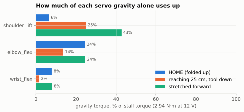
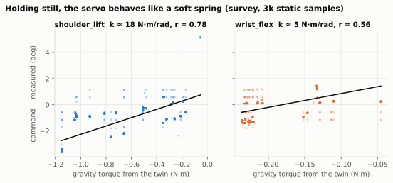
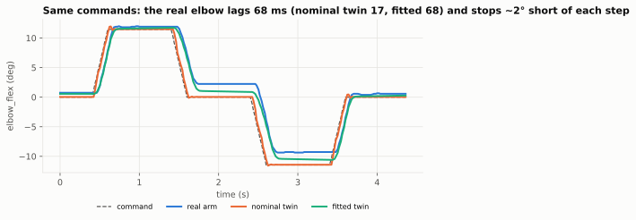
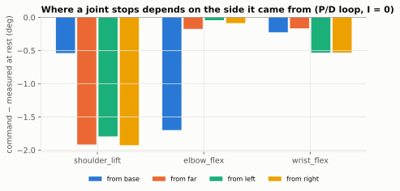
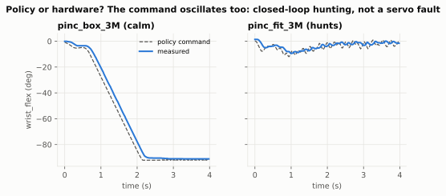

# From servo to policy: what an SO-101 does to your learned behaviour

*Draft, 2026-10-20. Figures are generated from this repo's logged runs (`uv run blog-figs`);
numbers in the text come from the same data. Marked TODO = still to measure or write.*

When a learned policy misbehaves on a real arm, the cause can sit in five places: the **policy**,
the **controller** that turns its commands into motor effort, the **mechanism** (gears, links,
mass), the **calibration** (where the robot thinks its joints are), or **vision** (where it
thinks the world is). This series takes one cheap, popular arm, the SO-101, and goes down to the
servo to find out which layer does what, with measurements for each.

It started from a practical question and from
[Tune to Learn](https://younghyopark.me/tune-to-learn/) (Bronars, Park, Agrawal), which shows on
a Franka that position-controller gains change how well policies learn, by over 30 % success for
behaviour cloning on the same data, and that stiff or overdamped gains hurt sim-to-real. A Franka
lets you set those gains. An SO-101 hides them inside a €15 hobby servo. What does that do?

## 1. The arm, as gravity sees it

Six Feetech STS3215 servos, one per joint: shoulder pan, shoulder lift, elbow, wrist flex, wrist
roll, and the gripper (here a PincOpen parallel gripper with a wrist camera). Link lengths in the
twin: shoulder to elbow 116 mm, elbow to wrist 135 mm, wrist to closed fingertip 190 mm.

| Joint | Mass it moves (model) |
|---|---|
| shoulder_pan | 598 g |
| shoulder_lift | 498 g |
| elbow_flex | 395 g |
| wrist_flex | 291 g |
| wrist_roll | 212 g (gripper + camera) |

*Masses are the model's (Menagerie links + an estimated 212 g for gripper and camera).
TODO: weigh the links and the gripper.*

The lift and elbow do the heavy lifting: stretched forward, gravity alone uses **43 %** of the
lift's stall torque before the policy asks for anything. Folded up, the elbow carries a quarter of
its capacity. The wrist is nearly free.

## 2. Inside the STS3215

*TODO: teardown photo / diagram: DC motor, 4-stage metal gear train, output shaft, magnetic
encoder, controller board.*

What the follower uses (12 V version, STS3215-C018): about **30 kg·cm (≈2.9 N·m) stall torque**,
a **1:345 metal gearbox**, and a **12-bit magnetic encoder** on the output shaft (4096 steps per
turn, 0.088°). The servo closes its own position loop on that encoder. The host only sends goal
positions over a serial bus, 50 times a second here.

The registers, read from our six servos (firmware 3.10):

| Register | Value | What it means for behaviour |
|---|---|---|
| P gain | 16 (24 on lift and elbow) | stiffness of the position loop |
| D gain | 32 | damping |
| **I gain** | **0** | nothing removes a steady error |
| Dead zone | 1 step each way (±0.088°) | the configured deadband is tiny… |
| Acceleration | 254 (max) | no motion profile: every 20 ms step goes straight to the motor |
| Torque limit | 100 % (gripper 50 %) | |

Two numbers matter most for what follows: **I = 0** and **acceleration at maximum**.

## 3. Holding still: the servo is a spring

With only P and D, the motor's effort is proportional to the position error. So at rest the
error is whatever it takes to hold the load: the arm sags. From 3,000 still samples across the
workspace, the shoulder behaves like a spring of about **18 N·m/rad**. At 43 % of stall torque
that is ~4° of sag, roughly 2 cm at the fingertip when stretched out.

## 4. Moving: late, and short of the target

The same commanded steps, played on the real arm and on two MuJoCo twins:

- The real elbow **lags the command by 68 ms**; the nominal twin (stiff Menagerie actuators) by
  17 ms. A fitted twin reproduces the lag.
- The real elbow **stops about 2° short of each step, on whichever side it came from**. That is
  20 times the configured dead zone.

The fingertip-accuracy runs show the same thing in a different way: approach a target from the
base and the lift stops 0.5° short; approach it from the far side and it stops 1.9° short. The
cause is the combination of no integral term, gearbox friction (the reason a 1:345 servo can't be
back-driven), and gravity. It shows up as backlash, but it isn't gear lash: it is a deadband of the
control loop, about 2° wide, and it depends on the approach.

## 5. What the policy sees

Two reach policies trained in MuJoCo, run zero-shot on the real arm (`--settle`, 1 rad/s):

| Policy | Trained on | Real arm |
|---|---|---|
| `pinc_box_3M` | nominal twin + wide domain randomisation | 20/20, median 0.42 cm, calm |
| `pinc_fit_3M` | the fitted twin (lag + friction matched to open-loop replay) | 17/20, hunts |

The twin that matched the step response better produced the *worse* policy. Its commands
oscillate (dashed line, right): the hunting is a closed-loop interaction between the policy and the
servo, not a servo fault. No single twin we built reproduces both behaviours (calm for one policy,
hunting for the other); the real arm sits between a lively nominal twin and an over-damped fitted
one.

TODO: the closed-loop twin table (`gap closed-loop`) as a figure.

## 6. In the world: where the fingertip really goes

TODO after the second `tip-accuracy` run (raw vs settle-trimmed). First run: at a centre target
the fingertip ended up 12 mm short and 13.5 mm low of where the arm meant to put it, and touched
the board. About half of that is the stopping error above (6–10 mm, visible in the encoders); the
rest is the camera's estimate of the board (a few mm) and the fingertip model (~6 mm longer than
modelled). Repeatability between opposite approaches: **1.5 mm**.

## 7. Is it the policy, the controller, the mechanism, calibration or vision?

| Symptom | First check | Points to |
|---|---|---|
| Arm oscillates at the goal | does the **command** oscillate too? (trajectory log) | yes → closed loop / policy; no → servo gains |
| Stops short, same side every time | command − measured at rest, by approach | controller (I = 0) + friction |
| Stops short, constant in the tool frame | encoders agree with target, camera disagrees | fingertip / tool model |
| Errors grow with reach | error vs gravity torque | sag (servo stiffness) |
| Errors depend on where the camera put the target | arm-referenced vs camera-referenced target | camera extrinsics |
| Two calibrations disagree | fit the board scale too | the calibration target, not the arm |
| Works in sim, fails real, *same* commands | replay the commands on both (`gap compare`) | actuator model |
| Different commands for the same scene | policy input / observation pipeline | policy or perception |

Every row is a tool in this repo (`harness`, `gap`, `camcal-wrist`, `tip-accuracy`).

## 8. Next: tune to learn, on hobby servos

The servo exposes P, D, I, dead zone and acceleration as registers. That makes the Tune-to-Learn
question cheap to ask on a $100 arm:

1. Sweep the registers (P, I > 0, acceleration < max) and measure each setting's step response,
   stopping error and stiffness, as above.
2. For each setting, fit a twin, train the same reach policy, and run it real: success, settle
   error, smoothness (jerk), hunting.
3. Do the same with behaviour cloning from teleoperated demos.

Plus: a settle-trim outer loop (software integral action), a contact guard, jerk-limited
commands, and backlash as domain randomisation, each measured the same way.
